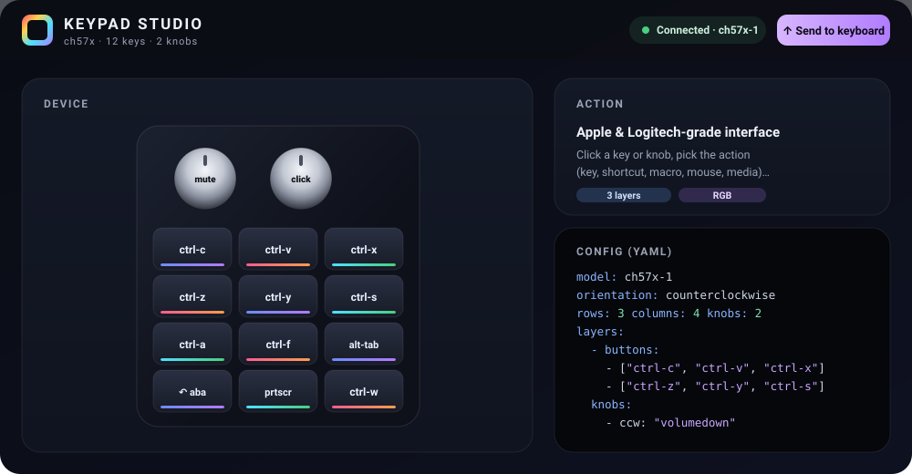

# ⌨️ Keypad Studio

<p align="center">
  
</p>

Interface gráfica (estilo Apple/Logitech) para configurar **macropads CH57x**
— aqueles teclados de **12 teclas + 2 knobs** com RGB, populares no AliExpress —
por cima da excelente ferramenta de linha de comando
[`ch57x-keyboard-tool`](https://github.com/kriomant/ch57x-keyboard-tool).

Tudo roda **localmente** no seu PC (Windows). Nada é enviado para a internet.

> O software que vem com esses teclados é feio, só funciona no Windows e programa
> uma tecla por vez. O **Keypad Studio** dá uma interface bonita e completa:
> você clica na tecla, escolhe a ação e envia tudo de uma vez.

---

## ✨ O que faz

- 🎛️ **Visual do seu teclado** — 12 teclas + 2 knobs (girar ↺ · apertar ● · girar ↻), com RGB.
- 🧩 **3 layers** (camadas), trocadas pelo botão lateral do teclado.
- ⌨️ Ações por tecla/knob:
  - **Tecla** única, **Atalho** (`ctrl-c`), **Macro/sequência** (até 5 passos, com `delay`),
  - **Mouse** (clique, scroll, mover, arrastar) e **Mídia** (play, volume, brilho…),
  - modo **Avançado** com a sintaxe crua e validação ao vivo.
- 🔄 **Sincronizar** — traz de volta a última config enviada (o teclado é *write-only*; veja abaixo).
- 💡 **Iluminação (LED)** — modos (backlight / shock / press) e cores, por layer.
- 💾 **Perfis**, **Importar/Exportar** `.yaml`, e **Validar**.
- 🧭 **Orientação** — desenha o teclado do jeito que você segura (ex.: knobs em cima).

---

## 🚀 Instalação / uso (Windows, 1 clique)

1. Conecte o teclado por **cabo USB**.
2. **Instale o USBDK** (necessário só para *gravar* no teclado):
   dê duplo clique em [`drivers/UsbDk_1.0.22_x64.msi`](drivers/) → Next → Finish →
   **reinicie o PC**. (Ou baixe a versão mais nova em
   [daynix/UsbDk](https://github.com/daynix/UsbDk/releases).)
3. Dê **duplo clique** em **`Keypad Studio.bat`**.
   - Abre uma janelinha preta (o *bridge* local) — **deixe aberta**.
   - O navegador abre sozinho em `http://localhost:8787`.
4. Clique numa tecla/knob, escolha a ação, e **Enviar p/ teclado**. 🎉

Para fechar, feche a janelinha preta.

> **Modo prévia:** você pode abrir `studio/index.html` direto no navegador só para
> montar/exportar a config, mas **Validar / Enviar / LED / Sincronizar** só funcionam
> quando aberto pelo `Keypad Studio.bat` (que sobe o bridge e fala com o `.exe`).

---

## 🔄 Sobre “ler” a config que já está no teclado

Esses teclados CH57x (e a ferramenta oficial) **só sabem gravar** — a comunicação
USB é de mão única. **Não existe** como ler de volta o que está no chip.

O Keypad Studio contorna isso de forma prática: o bridge **guarda uma cópia da
última config enviada** (`studio/.last-config.yaml`). Como nada mais escreve no
teclado além deste app, essa cópia **é** o que está gravado. Por isso o botão
**Sincronizar** (e o carregamento automático em sessões novas) traz sua config
de volta mesmo que você não tenha salvo nada.

---

## 📦 O que vem no repositório

```
Keypad-Studio/
├─ Keypad Studio.bat         ← clique aqui
├─ studio/
│  ├─ index.html             ← a interface
│  ├─ bridge.ps1             ← servidor local (PowerShell, nativo do Windows)
│  ├─ exemplo-layout.yaml    ← layout de exemplo (produtividade + vídeo)
│  └─ README.md
├─ bin/
│  ├─ ch57x-keyboard-tool.exe   (binário oficial v1.7.0)
│  └─ example-mapping.yaml
├─ drivers/
│  └─ UsbDk_1.0.22_x64.msi      (driver USB — Daynix)
├─ docs/
│  ├─ hero.svg
│  └─ acoes-ch57x.md         ← todas as ações suportadas
└─ upstream/
   └─ ch57x-keyboard-tool/   ← CÓDIGO-FONTE completo (Rust) p/ compilar e estender
```

---

## 🛠️ Compilar e estender

O binário em `bin/` já está pronto, mas o **código-fonte completo** da ferramenta
vai em [`upstream/ch57x-keyboard-tool/`](upstream/ch57x-keyboard-tool) — assim você
pode compilar sua própria versão, adicionar ações, suportar novos modelos ou
construir outras ferramentas por cima do mapeamento.

Para compilar (precisa do [Rust](https://rustup.rs/)):

```bash
cd upstream/ch57x-keyboard-tool
cargo build --release
# binário gerado em: target/release/ch57x-keyboard-tool(.exe)
```

Depois é só copiar o seu `ch57x-keyboard-tool.exe` para a pasta `bin/` do app
(substituindo o que vem pronto) — o bridge usa o que estiver lá.

Pontos de partida no código: `src/parse.rs` (sintaxe das ações),
`src/keyboard/` (protocolo por modelo — ex. `k884x.rs` para o seu 0x8842),
`src/config.rs` (formato do YAML).

---

## 🙏 Créditos

Este projeto é uma **interface** por cima de ferramentas de terceiros — todo o
trabalho de engenharia reversa do protocolo é delas:

- **[ch57x-keyboard-tool](https://github.com/kriomant/ch57x-keyboard-tool)** —
  Mikhail Trishchenkov. Licença MIT. (Código-fonte completo incluído, sem
  modificações, em `upstream/ch57x-keyboard-tool/`.)
- **[UsbDk](https://github.com/daynix/UsbDk)** — Daynix. Licença Apache-2.0.

Veja [THIRD-PARTY.md](THIRD-PARTY.md) para os avisos de licença.

A interface Keypad Studio é distribuída sob a licença [MIT](LICENSE).
